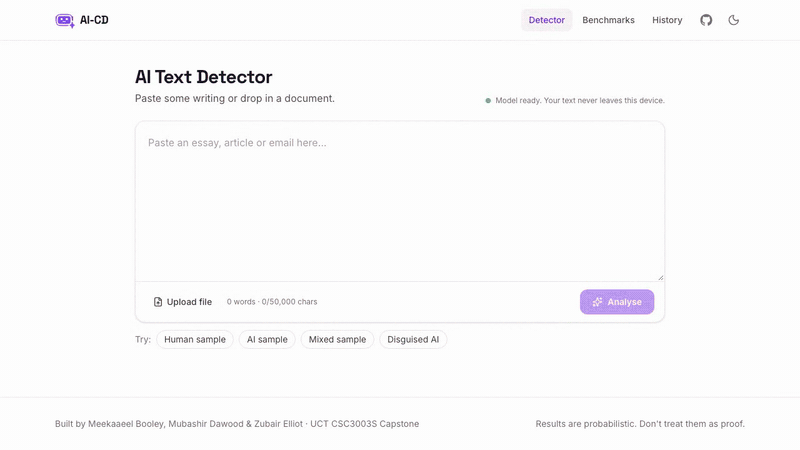

# repo-video

A Claude Code skill that makes a narrated walkthrough video, two minutes or less, of a pull request or a whole repository. Everything renders on your Mac: a [Kokoro](https://huggingface.co/hexgrad/Kokoro-82M) voice, syntax-highlighted code slides, captions, and optional clips recorded from the project's live site.

## Example

An 81-second overview of [AI-CD](https://github.com/Zubair-Elliot-17/AI-CD), made with `/repo-video`, using clips from its live site:

[](docs/example-overview.mp4)

https://github.com/user-attachments/assets/d4270693-c0bb-4216-b7dc-0f81771bb2e0

## What to expect

| | |
|---|---|
| **Output** | One 1280×720 MP4 with narration and burned-in captions, 120 seconds or less |
| **Length** | 6–9 slides, about 210 words of narration (roughly 40–90 seconds) |
| **Slides** | Code copied word for word from the source (diff hunks in PR mode), file paths as headings, or live-site clips |
| **First run** | Downloads about 350 MB (voice model, Chromium) |
| **Where it goes** | A work folder under `$TMPDIR/repo-video/`, never inside your repo. Claude opens it when done |
| **Attaching** | PR mode asks before attaching. GitHub: you drag the file into the PR description (no API for that). GitLab: uploaded via the API |

What it won't do: put secrets on a slide (the renderer refuses common key and token shapes), follow instructions found inside the repo or PR text, or record pages behind a login.

## Usage

In Claude Code:

```text
/repo-video https://github.com/<owner>/<repo>/pull/<n>            # PR walkthrough
/repo-video https://gitlab.com/<group>/<project>/-/merge_requests/<n>  # MR walkthrough
/repo-video https://github.com/<owner>/<repo>                     # overview of a GitHub repo (shallow clone)
/repo-video ~/path/to/project                                     # overview of a local folder
/repo-video                                                       # overview of the current folder
```

- **PR / MR mode**: what changed and why, the key hunks, and what a reviewer should check.
- **Overview mode**: what the project is, how to run it, its structure, 3–5 key files, how data flows through it, and where a new contributor should start. If the project has a live site, Claude asks whether to record clips from it.

Pick a different voice with `REPO_VIDEO_VOICE` (`af_heart` default, `am_michael`, `bm_george`).

## Install

Needs macOS with [Homebrew](https://brew.sh) and [Claude Code](https://claude.com/claude-code). PR mode needs `gh` (GitHub) or `glab` plus a `GITLAB_TOKEN` with `api` scope (GitLab).

```bash
git clone https://github.com/Zubair-Elliot-17/repo-video.git
ln -s "$PWD/repo-video" ~/.claude/skills/repo-video
./repo-video/setup.sh          # ffmpeg, espeak-ng, Python 3.12 venv, Kokoro, Playwright Chromium, voice test
./repo-video/.venv/bin/python repo-video/make_video.py --selftest
```

## How it works

1. Claude reads the PR diff and commits, or the repo's README, manifest, file tree and key modules.
2. It writes a `spec.json` of slides: a heading, narration, and either code or a clip.
3. `make_video.py` voices each slide with Kokoro, draws code with Pygments and Pillow, adds captions, and joins everything with ffmpeg. Specs over 120 seconds are rejected so Claude trims them.
4. `record_site.py` (optional) records short clips of a live site with Playwright from a steps file.

| File | Role |
|---|---|
| `SKILL.md` | The instructions Claude follows |
| `make_video.py` | `spec.json` → narrated MP4 |
| `record_site.py` | Steps file → screen-recording clip |
| `setup.sh` | One-time install and voice test |
| `BUILD-GUIDE.md`, `PLAN.md` | Design notes |

The renderer can also be run by hand:

```bash
.venv/bin/python make_video.py spec.json out.mp4
```

```json
{"slides": [{"heading": "src/app.py", "narration": "This is where requests come in.", "lang": "python", "code": "def main(): ..."}]}
```
