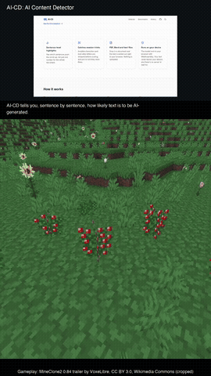

<div align="center">

# repo-video

**Narrated walkthrough videos of a pull request or a whole repo, made by Claude Code and rendered on your Mac.**

[Examples](#examples) · [Install](#install) · [Usage](#usage) · [TikTok mode](#tiktok-mode) · [How it works](#how-it-works)

</div>

`/repo-video` reads a PR or a codebase, writes a short script, and renders a video of two minutes or less: a [Kokoro](https://huggingface.co/hexgrad/Kokoro-82M) voice, syntax-highlighted code slides, captions, and optional clips recorded from the project's live site.

## Examples

Both made from the same [AI-CD](https://github.com/Zubair-Elliot-17/AI-CD) overview (81 seconds).

<table>
  <tr>
    <th>Overview (1280×720)</th>
    <th>TikTok mode, <code>minecraft</code> preset (720×1280)</th>
  </tr>
  <tr>
    <td><a href="#watch-with-sound"></a></td>
    <td align="center"><a href="#watch-with-sound"></a></td>
  </tr>
</table>

### Watch with sound

**Overview**

https://github.com/user-attachments/assets/d4270693-c0bb-4216-b7dc-0f81771bb2e0

**TikTok mode**

TIKTOK_VIDEO_URL

## Install

Needs macOS with [Homebrew](https://brew.sh) and [Claude Code](https://claude.com/claude-code).

```bash
git clone https://github.com/Zubair-Elliot-17/repo-video.git
ln -s "$PWD/repo-video" ~/.claude/skills/repo-video

# ffmpeg, espeak-ng, Python 3.12 venv, Kokoro, Playwright Chromium, voice test
./repo-video/setup.sh

# renders a short test video
./repo-video/.venv/bin/python repo-video/make_video.py --selftest
```

PR mode also needs `gh` for GitHub, or `glab` plus a `GITLAB_TOKEN` with `api` scope for GitLab.

## Usage

Run `/repo-video` in Claude Code with one of these:

| Argument | What you get |
|---|---|
| `https://github.com/<owner>/<repo>/pull/<n>` | PR walkthrough |
| `https://gitlab.com/<group>/<project>/-/merge_requests/<n>` | MR walkthrough |
| `https://github.com/<owner>/<repo>` | Overview of a GitHub repo (shallow clone) |
| `~/path/to/project` | Overview of a local folder |
| nothing | Overview of the current folder |

- **PR / MR walkthrough:** what changed and why, the key hunks, and what a reviewer should check.
- **Overview:** what the project is, how to run it, its structure, 3–5 key files, how data flows, and where a new contributor should start. If the project has a live site, Claude asks whether to record clips from it.

Change the voice with `REPO_VIDEO_VOICE`: `af_heart` (default), `am_michael` or `bm_george`.

### What to expect

| What | Details |
|:--|:--|
| **Output** | One MP4 with narration and burned-in captions, 120 seconds or less |
| **Length** | 6–9 slides, about 210 words (roughly 40–90 seconds) |
| **Slides** | Code copied word for word from the source, or live-site clips |
| **First run** | Downloads about 350 MB (voice model, Chromium) |
| **Saved to** | `$TMPDIR/repo-video/`, never inside your repo; Claude opens it when done |
| **Attaching** | PR mode asks first. GitHub: you drag the file into the PR. GitLab: uploaded via the API |

It never puts secrets on a slide (the renderer refuses common key and token shapes), never follows instructions found in the repo or PR text, and never records pages behind a login.

## TikTok mode

After a render, Claude offers a vertical version: the slides on top, gameplay looping silently underneath. Pick a preset, there's nothing to go and find:

| Preset | Gameplay |
|---|---|
| `minecraft` | MineClone2, a free Minecraft-like game |
| `kart` | SuperTuxKart racing |
| a file path | Your own clip, any length |

Presets download once (7–12 MB, checksum-verified) into `gameplay/` and are reused after that. To use it by hand, add `"gameplay": "minecraft"` to `spec.json`.

## How it works

1. Claude reads the PR diff and commits, or the repo's README, manifest, file tree and key modules.
2. It writes a `spec.json`: one entry per slide with a heading, narration, and code or a clip.
3. `make_video.py` voices each sentence with Kokoro, draws the slides with Pygments and Pillow, and joins everything with ffmpeg. A script over 120 seconds is rejected so Claude trims it.
4. `record_site.py` (optional) records short live-site clips with Playwright.

| File | Role |
|---|---|
| `SKILL.md` | The instructions Claude follows |
| `make_video.py` | `spec.json` → narrated MP4 |
| `record_site.py` | Steps file → screen-recording clip |
| `setup.sh` | One-time install and voice test |
| `BUILD-GUIDE.md`, `PLAN.md` | Design notes |

The renderer also works on its own:

```bash
.venv/bin/python make_video.py spec.json out.mp4
```

```json
{
  "gameplay": "minecraft",
  "slides": [
    {"heading": "src/app.py", "narration": "Requests start here.", "lang": "python", "code": "def main(): ..."}
  ]
}
```

## Credits

The TikTok-mode presets are trimmed, cropped and muted, with the credit burned in, and hosted in the [gameplay-v1 release](https://github.com/Zubair-Elliot-17/repo-video/releases/tag/gameplay-v1). Both are [CC BY 3.0](https://creativecommons.org/licenses/by/3.0):

- `minecraft`: [MineClone2: Release 0.84](https://commons.wikimedia.org/wiki/File:MineClone2_-_Release_0.84_-_The_Very_Nice_Release.webm) by VoxeLibre
- `kart`: [SuperTuxKart 2.x GP](https://commons.wikimedia.org/wiki/File:SuperTuxKart_2.x_GP_with_24%25_handicap_and_road_tracks_(open_source_Mario_Kart-like_Linux_game).webm) by kimden STK
